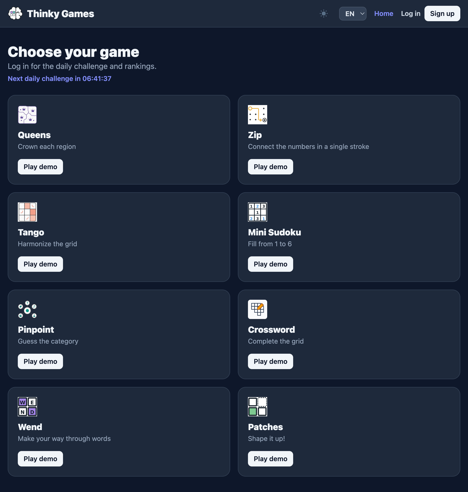

<p align="center">
  
</p>

<h1 align="center">Thinky Games</h1>

<p align="center">
  A browser-based collection of daily logic puzzles. Play a quick demo, return for a fresh daily challenge, and compare your time on the leaderboard.
</p>

<p align="center">
  <a href="https://react.dev"></a>
  <a href="https://vite.dev"></a>
  <a href="https://fastapi.tiangolo.com"></a>
  <a href="https://www.docker.com"></a>
</p>



> [!IMPORTANT]
> **What it does:** Thinky Games brings several short puzzle formats into one place, with guest demos, authenticated daily games, saved results, and a ranking system.

## Install and run

> [!NOTE]
> You need Node.js with npm, Python 3.11-3.13, [uv](https://docs.astral.sh/uv/), and Docker Compose. Docker runs the local MySQL database and the optional dictionary PostgreSQL service.

1. **Clone the repository.** Copy its URL from GitHub's **Code** menu.

   ```bash
   git clone <repository-url>
   cd thinky-games
   ```

2. **Start the databases.**

   ```bash
   docker compose up -d db dictionary-db
   ```

3. **Install the backend, frontend, and dictionary service dependencies.**

   ```bash
   (cd backend && uv sync)
   (cd dictionary-service && uv sync)
   (cd frontend && npm install)
   ```

4. **Run the dictionary service** in one terminal.

   ```bash
   just run-dictionary
   ```

5. **Run the API** in a second terminal.

   ```bash
   just run-backend
   ```

6. **Run the web app** in a third terminal.

   ```bash
   just run-frontend
   ```

Open [localhost:5173](http://localhost:5173) to play. The API documentation is available at [localhost:8000/docs](http://localhost:8000/docs) and the dictionary service docs at [localhost:8100/docs](http://localhost:8100/docs).

> [!TIP]
> From the repository root, `just install`, `just db-up`, `just dict-db-up`, `just run-dictionary`, `just run-backend`, and `just run-frontend` provide the same development workflow through the included task runner.

### Run the full stack with Docker

```bash
docker compose up --build
```

Open [localhost:8080](http://localhost:8080). Stop the stack with `docker compose down`.

## Features

- Daily puzzle sessions with a countdown to the next challenge.
- Guest demo mode alongside authenticated daily play.
- Puzzle completion times, persistent scores, and protected leaderboards.
- Seven puzzle formats: Zip, Queens, Tango, Mini Sudoku, Pinpoint, Wend, and Patches.
- English, Spanish, and German interface translations.
- Database migrations, automated puzzle generation, and backup support.
- A container-ready development and deployment setup.

## Stack

| Layer    | Technology                                  |
| -------- | ------------------------------------------- |
| Web app  | React, Vite, Tailwind CSS, Zustand, i18next |
| API      | FastAPI, SQLAlchemy, Alembic                |
| Database | MySQL 8, PostgreSQL 16 (dictionary)         |
| Tooling  | uv, pytest, Vitest, Docker Compose, Just    |

## Useful commands

```bash
just test              # Run backend tests
just test-cov          # Run backend tests with coverage
just build-frontend    # Create the production web bundle
just run-dictionary    # Run the dictionary service locally
just dict-db-up        # Start only the dictionary PostgreSQL container
docker compose logs -f # Follow all container logs
```

## Dictionary service

A standalone FastAPI service manages curated words for word games. It stores words in PostgreSQL with one table per language (`spanish_words`, `english_words`, `german_words`) and exposes CRUD and bulk-import endpoints.

When `DICTIONARY_SERVICE_URL` is configured, the main backend reads word pools from this service for Wend and Pinpoint instead of using the local hardcoded lists.

Seed data lives in `dictionary-service/scripts/data/` and can be imported with:

```bash
cd dictionary-service
python3 scripts/import_seed.py scripts/data/seed_es.json es
python3 scripts/import_seed.py scripts/data/seed_en.json en
python3 scripts/import_seed.py scripts/data/seed_de.json de
```
